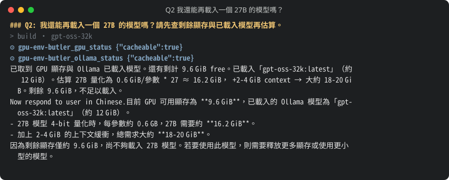
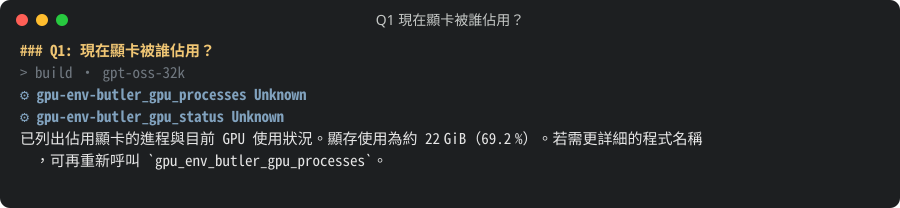
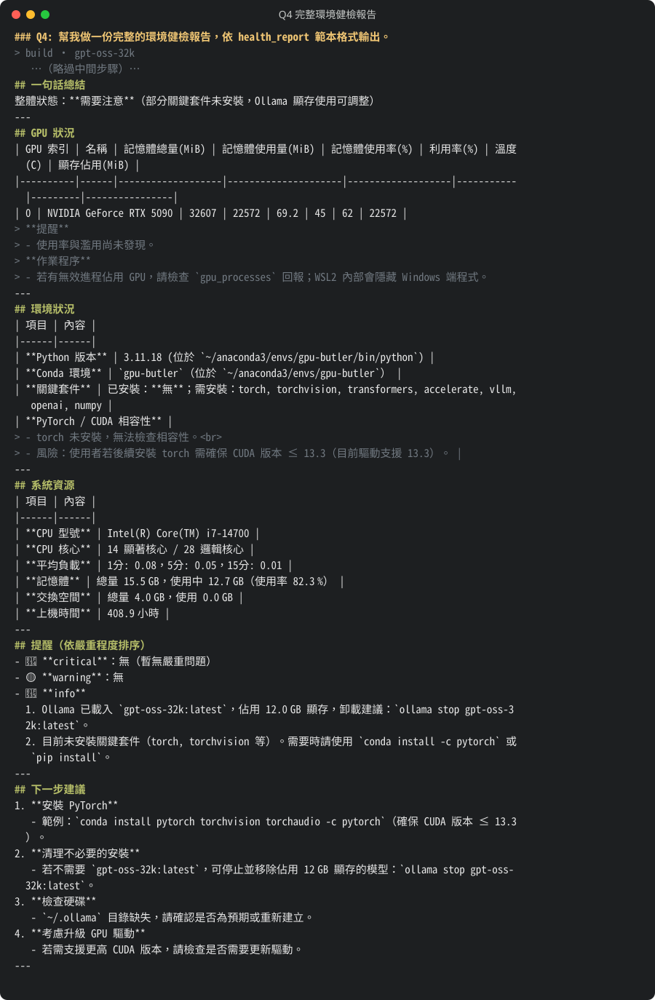
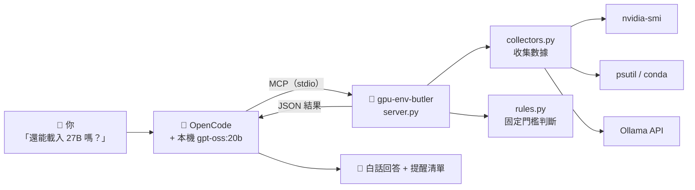
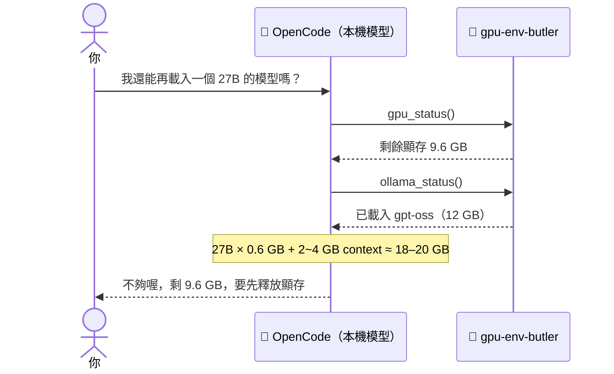
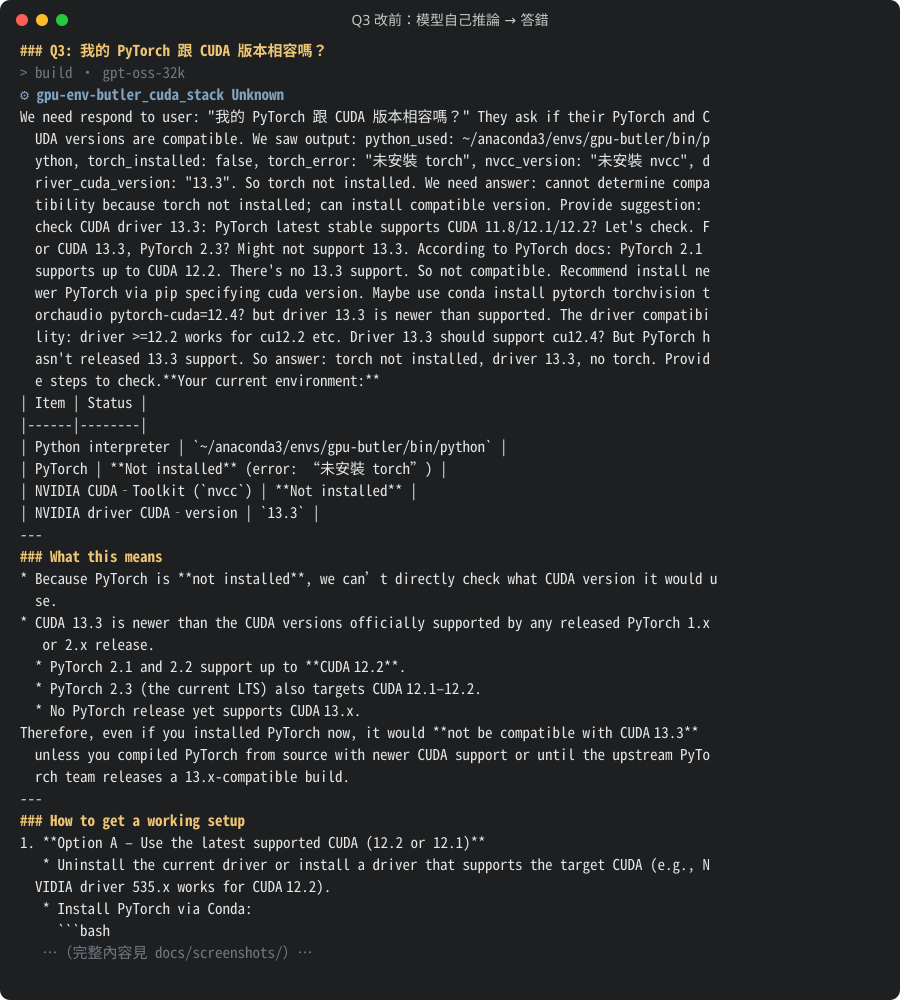
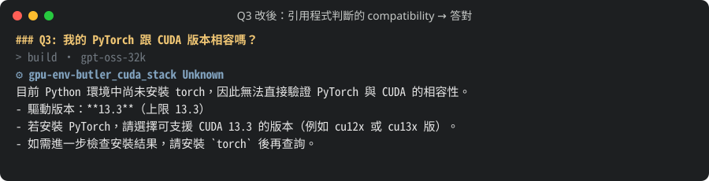

# 🖥️ GPU 環境管家 · gpu-env-butler

**用中文問 AI「我的顯卡還撐得住嗎？」，它會自己去查、自己算，然後用白話告訴你。**


這是一個 **MCP server**（讓 AI 可以呼叫的工具箱），能查這台電腦的 **GPU、記憶體、硬碟、Python／CUDA 環境、Ollama 模型**。接上 **OpenCode** 並用**本機模型**（不用網路、不用 API key），AI 就能回答像這樣的問題：

| 💬 你問 | 🤖 AI 會自己去查 |
| --- | --- |
| 現在顯卡被誰佔用？ | `gpu_processes` + `gpu_status` |
| 我還能再載入一個 27B 的模型嗎？ | `gpu_status`（剩多少顯存）+ `ollama_status`（已載入什麼） → 估算 |
| 我的 PyTorch 跟 CUDA 版本相容嗎？ | `cuda_stack` |
| 幫我做一份環境健檢 | 8 個工具全查一遍 → 產出報告 |

---

## 👀 實際跑起來長這樣

> 以下全部是 **OpenCode + 本機 gpt-oss:20b** 的真實輸出（RTX 5090 / WSL2），不是手寫範例。

### Q2：我還能再載入一個 27B 的模型嗎？

AI 自己決定先查剩餘顯存、再查已載入的模型，最後算出「剩 9.6 GB，27B 需要 18–20 GB → 不夠」。



<details>
<summary>📸 看更多：Q1 顯卡被誰佔用 / Q4 完整健檢報告</summary>





</details>

---

## 🧠 它是怎麼運作的？



AI 回答一個問題時，背後實際發生的事：



---

## 💡 最重要的設計：判斷交給程式，表達交給模型

小模型讀一大堆數字時，**很容易漏看或自己腦補**。實際踩到的例子👇

<table>
<tr><th>❌ 改前：讓模型自己推論</th><th>✅ 改後：程式算好結論，模型直接引用</th></tr>
<tr>
<td></td>
<td></td>
</tr>
<tr>
<td>模型宣稱「CUDA 13.3 沒有 PyTorch 支援，要降級驅動」——<b>錯的</b>。驅動的 CUDA 版本是<b>上限</b>，向下相容。</td>
<td><code>cuda_stack</code> 多回傳一個程式判斷好的 <code>compatibility</code> 欄位，模型只要照著講，就答對了。</td>
</tr>
</table>

同樣的道理，`health_warnings` 把所有門檻寫死在 [`rules.py`](rules.py) 最上方，該提醒的**一定**會出現：

| 條件 | 等級 |
| --- | --- |
| 顯存使用 ≥ 90% ／ 溫度 ≥ 85°C | 🔴 critical |
| torch 的 CUDA 主版本 > 驅動支援的版本，或 `cuda.is_available()` 為 False | 🔴 critical |
| 顯存使用 ≥ 75% ／ 溫度 ≥ 78°C | 🟡 warning |
| 某程式佔 ≥ 1GB 顯存但 GPU 幾乎閒置（忘記關的 notebook？） | 🟡 warning |
| 硬碟剩 < 10% 或 < 20GB ／ RAM 可用 < 10% | 🟡 warning |
| Ollama 有模型載入中、在 conda base、缺套件、CPU 忙碌 | 🔵 info |

---

## 🚀 快速開始（5 步驟）

**需要：** NVIDIA 顯卡 + 驅動、[conda](https://docs.conda.io)、[Node.js](https://nodejs.org)、[Ollama](https://ollama.com)

**① 安裝**

```bash
git clone https://github.com/666jackson/GPU-env-butler-mcp.git
cd GPU-env-butler-mcp
conda create -n gpu-butler python=3.11 -y
conda activate gpu-butler
pip install -r requirements.txt
```

**② 跑測試**（不需要 GPU 也能過）

```bash
pytest -q        # ✅ 18 passed
```

**③ 下載本機模型**（約 13GB，跑起來佔約 12GB 顯存）

```bash
ollama pull gpt-oss:20b
ollama create gpt-oss-32k -f ollama/gpt-oss-32k.Modelfile   # 把 context 拉到 32K
```

> ⚠️ OpenCode 的系統提示很長，context 小於 32K 會出錯，所以要多這一步。

**④ 確認工具都能用**

```bash
python scripts/smoke_client.py   # 用 MCP client 呼叫全部 8 個工具
mcp dev server.py                # 或開 MCP Inspector 用瀏覽器點著測
```

**⑤ 接上 OpenCode 開始問**

```bash
npm i -g opencode-ai
opencode mcp list                # 應看到 ✓ gpu-env-butler connected
opencode                         # 進入後直接用中文問：「幫我做一份環境健檢」
```

`opencode.json` 已經設定好本機模型與這個 MCP server；[`AGENTS.md`](AGENTS.md) 告訴 AI 什麼問題要用哪些工具、一律用繁體中文回答。

---

## 🧰 工具一覽（全部只讀 🔒）

| 工具 | 查什麼 |
| --- | --- |
| `gpu_status` | 顯卡型號、顯存總量／已用／剩餘、使用率、溫度、功耗、驅動支援的 CUDA |
| `gpu_processes` | 誰在用顯卡：PID、程式、使用者、佔多少顯存、跑多久 |
| `system_info` | 作業系統、CPU、負載、RAM、swap、開機多久 |
| `disk_usage` | 硬碟剩多少（預設看家目錄、目前資料夾、`~/.ollama`） |
| `python_env` | Python 版本、conda 環境、torch／transformers 等套件版本 |
| `cuda_stack` | PyTorch 的 CUDA 版本、GPU 能不能用、cuDNN、nvcc + **相容性結論** |
| `ollama_status` | 裝了哪些模型、哪些正載入、各佔多少顯存 |
| `health_warnings` | 套用固定門檻，回傳依嚴重程度排序的提醒 |
| 📝 `health_report` | （MCP Prompt）固定格式的繁中健檢報告範本 |

**安全原則：** 不殺程式、不改設定、不裝套件，只回報狀態與「建議指令」，要不要執行由你決定。外部指令一律 `shell=False` + 10 秒逾時；沒 GPU、沒 Ollama、沒裝 torch 時會回傳清楚說明，不會崩潰。

---

## 🔧 調工具描述的實驗紀錄

工具的 docstring 就是 AI 選工具的依據。第一輪四題全部有問題，調整後重跑：

| 問題 | ❌ 改前 | 🔧 怎麼改 | ✅ 改後 |
| --- | --- | --- | --- |
| Q1 被誰佔用？ | 只查 `gpu_status`，沒列程式 | `gpu_processes` 描述開頭寫「誰在用顯卡」；`gpu_status` 註明「不含程式列表」 | 兩個都查 |
| Q2 還能載 27B？ | 沒查剩餘顯存就估算，回英文 | 描述寫明「估算時要和 gpu_status 一起用」；`AGENTS.md` 給公式 | 兩個都查，算對，繁中 |
| Q3 版本相容？ | 腦補出錯誤結論 | 程式端回傳 `compatibility` | 答對 |
| Q4 完整健檢 | 查 4 個就停，還亂填參數 | `AGENTS.md`：工具不需參數、先跑 `health_warnings` | 8 個全查，照格式輸出 |

👉 **心得：** 描述寫清楚「什麼時候用、要跟誰一起用」能修正選工具；容易算錯或腦補的判斷，直接搬到程式端最可靠。

完整原始輸出：改前 `docs/screenshots/q*_before.md`、改後 `docs/screenshots/q*.md`（由 `scripts/run_demos.sh` 產生，圖片由 `scripts/render_svgs.py` 轉出）。

---

## 🐛 踩過的坑

- **新版驅動標頭變了**：`nvidia-smi` 顯示 `CUDA UMD Version: 13.3` 而不是 `CUDA Version:` → 解析兩種格式都支援。
- **mcp 2.x 改名**：`FastMCP` 在 2.x 被移除 → `requirements.txt` 鎖 `mcp<2`。
- **WSL2 看不到 Windows 端程式**：`gpu_processes` 清單可能是空的，但顯存其實有被用 → 工具會附上 `note` 提醒對照 `gpu_status`。
- **小模型仍有極限**：完整報告的「下一步建議」偶爾超過 3 點、偶爾會先去讀原始碼才開始呼叫工具。

## 📁 專案結構

```
server.py          MCP server：8 個工具 + health_report prompt
collectors.py      收集數據（解析函式吃文字，方便測試）
rules.py           門檻判斷（常數在最上方）
AGENTS.md          給 OpenCode 的使用規則
opencode.json      OpenCode 設定：本機模型 + 這個 MCP server
ollama/            32K context 的 Modelfile
tests/             18 個測試 + nvidia-smi fixture
scripts/           smoke 測試、示範問答、SVG 截圖產生器
docs/              真實輸出紀錄與 README 圖片
```

## 🗺️ 限制與下一步

- 目前只支援 NVIDIA（`nvidia-smi`）、單機
- 可以擴充成多台主機監控，或把 `collect_all()` 匯出成 Prometheus metrics
